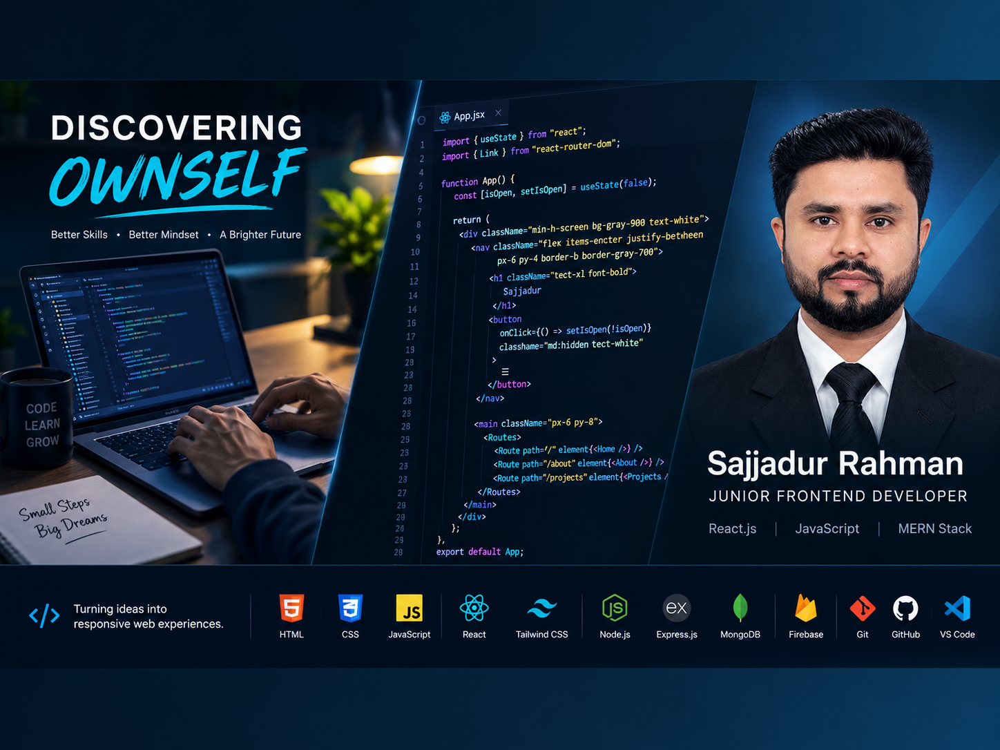

  

# Hi there, I'm Sajjadur Rahman 👋

### Junior Frontend Developer | React.js | JavaScript | MERN Stack Learner

I'm a Computer Science and Engineering graduate passionate about building responsive, interactive, and user-friendly web applications.

I enjoy turning ideas into functional digital experiences using modern web technologies. Through hands-on projects and continuous learning, I'm strengthening my frontend development skills and expanding my knowledge of full-stack web development.

My goal is to write clean, maintainable code and build practical applications that solve real-world problems.

---

## 🚀 What I Build

- **Frontend Applications** — Responsive websites and interactive user interfaces using React.js, JavaScript, HTML, and CSS.
- **API-Integrated Applications** — Dynamic web applications that fetch and display data from APIs.
- **Responsive Web Design** — User-friendly layouts for desktop, tablet, and mobile devices.
- **Interactive Projects** — Practical applications that demonstrate JavaScript logic, DOM manipulation, and user interactions.
- **Full-Stack Learning Projects** — Exploring backend development, authentication, databases, and the MERN stack.

---

## 🛠️ Tech Stack

**Languages**

**Frontend Development**

**Backend & Database**

**Tools & Workflow**

---

## 💻 Featured Projects

### 📚 English Dictionary
An interactive web application for searching English words and retrieving word information through an API.

- **Technologies:** HTML, CSS, JavaScript, API integration
- **Live Demo:** [View Project](https://english-dictionary7.netlify.app/)

### 🖼️ HorizonTechX Image Gallery
A frontend project focused on displaying images and practicing interactive web development.

- **Technologies:** HTML, CSS, JavaScript
- **Live Demo:** [View Project](https://sajjadursohag.github.io/HorizonTechX_Image-Gallery/#)

### 🧮 HorizonTechX Calculator
A calculator application built to practice JavaScript logic and user interactions.

- **Technologies:** HTML, CSS, JavaScript
- **Live Demo:** [View Project](https://sajjadursohag.github.io/HorizonTechX_Calculator/)
- **Source Code:** [GitHub Repository](https://github.com/sajjadursohag/HorizonTechX_Calculator)

### 💳 Payoo Mobile App
A mobile banking interface project demonstrating interactive UI development and JavaScript functionality.

- **Technologies:** HTML, Tailwind CSS, JavaScript
- **Live Demo:** [View Project](https://payoomobileap.netlify.app/)
- **Source Code:** [GitHub Repository](https://github.com/sajjadursohag/Payoo_Mobile_App)

### 🏢 G3 Architects
A responsive architecture website demonstrating layout design and responsive styling.

- **Technologies:** HTML, CSS
- **Live Demo:** [View Project](https://sajjadursohag.github.io/g3-architects-website/)

---

## 🌱 Currently Learning

- Strengthening JavaScript fundamentals and problem-solving skills
- Building reusable components and interactive applications with React
- Improving state management and API integration
- Exploring Node.js, Express.js, and MongoDB
- Learning better Git workflows and software development practices
- Building projects that reflect real-world requirements

---

## 🎓 Education

**Bachelor of Science in Computer Science & Engineering**

State University of Bangladesh | Graduated in 2021

---

## 🎯 Career Goals

- Build reliable, responsive, and maintainable web applications.
- Strengthen my JavaScript and React.js expertise.
- Grow into a capable full-stack developer through practical experience.
- Collaborate with experienced developers and contribute to real-world projects.
- Start my professional journey as a Junior Frontend Developer.

**Interested in:** Junior Frontend Developer roles, web development internships, and suitable freelance website projects.

---

## 🤝 Let's Connect

- **GitHub:** [@sajjadursohag](https://github.com/sajjadursohag)
- **Location:** Dhaka, Bangladesh

I'm always interested in learning, collaborating, and building useful web experiences.

  <i>"Consistent learning. Practical projects. Continuous improvement."</i>

